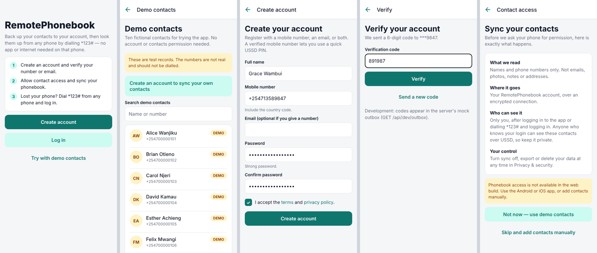
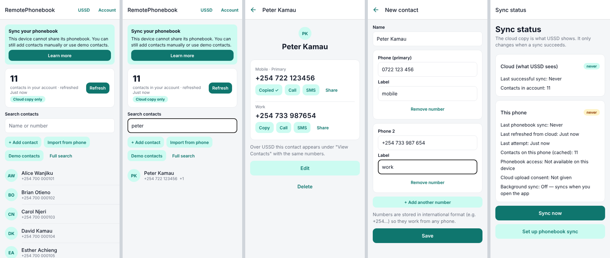
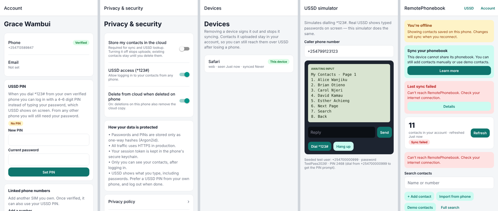
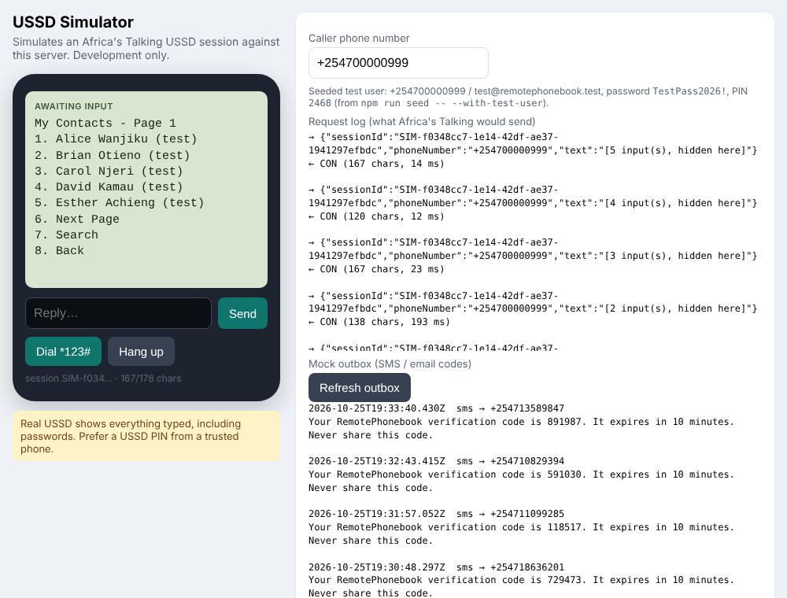

# RemotePhonebook

Sync your phone contacts to a secure cloud account, then look them up from **any phone** through an
Africa's Talking USSD code — no app or data connection needed on the second phone.

```
remotephonebook/
├── backend/   Node.js + TypeScript + Express 5 + PostgreSQL — REST API, sync engine, USSD gateway
├── mobile/    Expo SDK 58 (React Native + TypeScript, Expo Router) — Android / iOS / web
└── docs/      API, sync protocol, USSD design, security, deployment
```

| Doc | What's in it |
| --- | --- |
| [docs/API.md](docs/API.md) | Every endpoint, with sample `curl` requests |
| [docs/SYNC.md](docs/SYNC.md) | Incremental sync protocol, conflicts, deletions, duplicates |
| [docs/USSD.md](docs/USSD.md) | Menu tree, login design, carrier limits, the simulators |
| [docs/SECURITY.md](docs/SECURITY.md) | Threat model and the controls that are implemented |
| [docs/DEPLOYMENT.md](docs/DEPLOYMENT.md) | Database → HTTPS → Africa's Talking → going live |

## Quick start (local, mock mode — no credentials needed)

Prerequisites: Node 20+, PostgreSQL 14+.

```bash
# 1. Database
createuser rpb --pwprompt            # use rpb_dev_password to match .env.example
createdb remotephonebook -O rpb
createdb remotephonebook_test -O rpb # for the test suite

# 2. Backend
cd backend
cp .env.example .env                 # mock mode: no Africa's Talking calls are made
npm install
npm run migrate
npm run seed -- --with-test-user     # 10 demo contacts + a verified test user
npm run dev                          # http://localhost:4000

# 3. Mobile app (another terminal)
cd mobile
npm install
npx expo start                       # press w for web, a for Android, i for iOS
```

Then:

- **USSD simulator (browser):** http://localhost:4000/api/dev/ussd-simulator
- **USSD simulator (terminal):** `cd backend && npm run ussd:sim -- --phone +254700000999`
- **USSD simulator (in the app):** Home → "USSD" (development builds only)
- **One-time codes (mock SMS/email outbox):** http://localhost:4000/api/dev/outbox

Development accounts created by the seed (never created in production):

| Account | Identifier | Password | USSD PIN |
| --- | --- | --- | --- |
| Test user (10 contacts, some with several numbers) | `+254700000999` / `test@remotephonebook.test` | `TestPass2026!` | `2468` (only from +254700000999) |
| Demo dataset (USSD "Demo Contacts", read-only) | `demo@remotephonebook.test` | `DemoPass2026` | — |

The demo contacts (Alice Wanjiku … James Ouma, `+2547000001xx`) are fictional test records and are
labelled as such everywhere; the numbers are not real.

## Tests

```bash
cd backend && npm test     # 84 tests against a real PostgreSQL test database (remotephonebook_test)
cd mobile  && npm test     # 12 sync-planner unit tests
cd mobile  && npx tsc --noEmit && npx expo export --platform web   # typecheck + full bundle
```

The backend suite covers: unit (phone/name normalisation, USSD input parsing, password policy),
registration/verification/login/lockout/recovery, sessions and expiry, contact CRUD, pagination and
search (including SQL/wildcard injection), cross-account isolation over REST and USSD, incremental
sync (create/update/delete/tombstones/cursors/conflicts/deletion policy/mass-delete guard/batch limits),
sync status accuracy, the full USSD menu tree (demo, login, PIN, OTP, paging, contact numbers, search,
recent, account, sync status, logout), session expiry and retries, carrier length limits, and rate limits.

## What works today

- Registration by phone and/or email with verification codes; login; logout; recovery; lockout.
- Mobile app: all screens listed in the spec (splash, registration, login, permission explanation,
  initial sync, contact list, contact details, search, sync status, account, devices, privacy,
  demo contacts, error/offline states), plus a dev USSD simulator.
- Contact import from the device phonebook (Expo SDK 58 `Contact.getAllDetails`), incremental two-way
  sync with cursors, conflict handling, tombstones, duplicate collapsing, retries with backoff,
  sync on app open, on phonebook change, manually, and OS-scheduled background sync.
- Copy / Call / SMS / Share for every number (native clipboard, dialer and SMS app — never automatic).
- USSD state machine implementing the Africa's Talking callback protocol (`CON`/`END`, `text/plain`),
  with demo mode, password / PIN / optional OTP login, paging that adapts to carrier length limits,
  multi-number contacts, search, recent contacts, account, sync status, logout, and
  "Send SMS" (texts the selected number to the caller so it can be tapped or copied).

## What is still needed for a live USSD deployment

These cannot be done from code; see [docs/DEPLOYMENT.md](docs/DEPLOYMENT.md):

1. An Africa's Talking account (username + API key) — sandbox first, then live.
2. A USSD service code provisioned by Africa's Talking (shared `*384*xxxx#`-style or dedicated).
   `*123#` in this repo is only a placeholder; no shortcode has been provisioned.
3. A public **HTTPS** URL for the backend, registered as the USSD channel callback.
4. An SMS sender ID (for verification codes and the USSD "Send SMS" action) and an email provider
   (email delivery is mock-only; plug a provider into `backend/src/services/messaging.ts`).
5. Native builds of the app (`eas build`) — phonebook access does not exist in the web build.
6. Real privacy policy and terms (the ones served at `/legal/*` are placeholders).

Nothing in this repository has been tested against a real carrier or a live Africa's Talking account.

## Screenshots

Captured from the web build at phone width (390×844) during an automated end-to-end run against the
local backend: registration → SMS-code verification → manual contact → demo contacts → copy number →
sync status → USSD simulator login → offline state.





